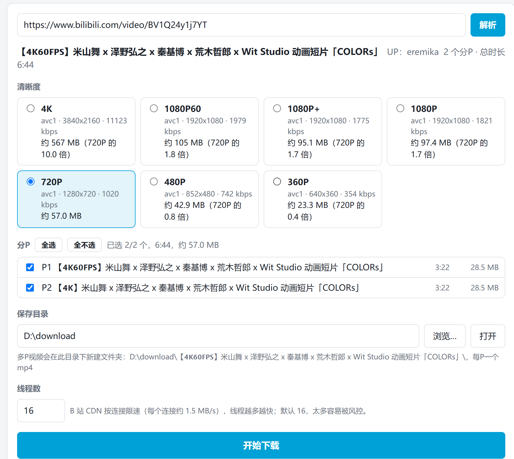

# bilidl

一个只用 Python 标准库写的 B 站（bilibili）视频下载器，带命令行和本地网页界面。

- **只走 API 和 CDN**：不依赖 www.bilibili.com 主站，主站连不上时也能下载。
- **多线程分段下载**：B 站 CDN 对每个连接单独限速（每个约 1.5 MB/s），所以默认开 16 个线程，并把链接换到更快的 CDN 节点。在作者的网络环境下，速度从约 2 MB/s 提升到约 24 MB/s。
- **断点续传**：中途取消或程序被关掉，下次会接着下。
- **每个分P一个 mp4**：音视频用 ffmpeg 封装在一起，不重新编码。
- **字幕**：可以同时下载 B 站的人工字幕和 AI 字幕，存成和视频同名的 .srt，也可以只下字幕（需要登录）。
- **弹幕**：可以同时下载弹幕，转成和视频同名的 .danmaku.ass，PotPlayer、VLC 打开视频就能看到滚动弹幕（需要装 biliass）。
- **网页界面**：选择清晰度时能看到各档的估算大小，可以勾选分P、选择保存目录，并实时查看进度、速度和剩余时间。
- **在线播放加速**：配合 Chrome 插件，在 B 站网页上看视频时，播放器的请求交给 bilidl 多线程预读，4K 倍速播放也不卡；弹幕、评论、历史记录照常。不用先下载。

<p align="center"></p>

> 仅供个人学习和备份自己有权观看的内容。视频版权归原作者所有，请遵守 B 站用户协议，不要传播下载的内容。

## 一键启动（不用命令行）

1. 在本页点击绿色的 **Code** 按钮 → **Download ZIP**，然后解压到任意文件夹。
2. 双击里面的 **`一键启动.bat`**。
3. 浏览器会自动打开下载页面：粘贴视频链接 → 解析 → 选择清晰度和保存位置 → 开始下载。

第一次运行时，如果电脑上没有 Python 或 ffmpeg，它会询问是否自动安装（通过 Windows 自带的 winget，按回车表示同意）。使用期间请不要关闭那个黑色窗口，关掉窗口程序就退出了；没下完的部分下次会接着下。

> 双击时如果 Windows 弹出「无法验证发布者」或 SmartScreen 提示，那是因为文件是从网上下载的。点「运行」或「更多信息 → 仍要运行」即可。脚本内容都是公开的，可以先用记事本打开看看。

想要 720P 及以上清晰度，需要先登录，见下面的[登录](#登录720p-及以上需要)一节。

## 环境要求

- Windows 10/11（核心下载逻辑跨平台，但启动脚本、选择文件夹和开机自启目前只适配了 Windows）
- Python 3.10 及以上，下载视频和字幕不需要安装任何第三方包
- [ffmpeg](https://ffmpeg.org/)：`winget install Gyan.FFmpeg`。程序会先在 PATH 里找，再找 WinGet 的安装目录。
- 可选：下载弹幕需要 [biliass](https://pypi.org/project/biliass/)（Python 3.11+，GPL-3.0）：`python -m pip install biliass`。不要加 `--user`，见 [docs/DANMAKU.md](docs/DANMAKU.md)。

用「一键启动」时，这几样都会自动检查。

## 命令行用法速览

```powershell
git clone <本仓库地址> bilidl
cd bilidl

# 命令行：先看各清晰度的大小，再下载
python bilidl.py BV1xxxxxxxxx --info
python bilidl.py BV1xxxxxxxxx -q 720 -o D:\Videos

# 网页界面：启动后会自动打开 http://127.0.0.1:8765/
python bilidl_web.py
```

把这个目录加入 PATH 后，可以直接用 `bilidl` 和 `bilidl-web` 两个命令（见 `bilidl.cmd` 和 `bilidl-web.cmd`）。

## 登录（720P 及以上需要）

未登录时最高只能下 480P；登录后可以下 720P/1080P；1080P60 及以上需要大会员。未登录时 B 站也不返回任何字幕（包括 AI 字幕）。

1. 在浏览器里登录 bilibili.com，按 F12 打开开发者工具，进入「应用/Application」→「Cookie」，复制 `SESSDATA` 的值。
2. 用下面任意一种方式保存：
   - 命令行：`python bilidl.py --set-cookie <SESSDATA>`
   - 网页界面：点击右上角的登录状态，粘贴后保存

cookie 只保存在本机的 `sessdata.txt` 里，这个文件已经写进 `.gitignore`。**它等同于你的登录凭证，不要上传或分享。**

## 命令行用法

```
bilidl <链接或BV号> [-q 清晰度] [-p 分P] [-o 目录] [-j 线程数] [--codec avc|hevc|av1]
bilidl <链接或BV号> --sub [auto|all|语言] [--danmaku] [--sub-only]
bilidl <链接或BV号> --info           只显示各清晰度的大小和字幕，不下载
bilidl --set-cookie <SESSDATA>
```

| 参数 | 说明 |
|---|---|
| `-q` | `360` / `480` / `720`（默认）/ `1080` / `1080+` / `1080p60` / `4k` / `best`；所选清晰度不可用时，自动降到最接近的较低清晰度 |
| `-p` | 例如 `1` 或 `1,3-5`；默认下载全部分P（链接里带 `?p=N` 时只下第 N P） |
| `-o` | 保存目录，默认是当前目录。多P视频会在里面新建一个以标题命名的子文件夹 |
| `-j` | 并发线程数，默认 16，最多 32。线程越多越快，但太多容易被 CDN 风控 |
| `--sub` | 同时下载字幕，存成 `<视频名>.<语言>.srt`。`auto`（不写值时的默认）：全部人工字幕，没有人工字幕时用 AI 识别的字幕；`all`：全部，包括 AI 翻译；也可以写语言代码，如 `zh,en`（`zh` 能匹配 `zh-CN`、`zh-Hans` 和 `ai-zh`）或 `ai-zh` |
| `--danmaku` | 同时下载弹幕，存成 `<视频名>.danmaku.ass`，播放器会自动加载。需要 biliass；样式和播放器设置见 [docs/DANMAKU.md](docs/DANMAKU.md) |
| `--sub-only` | 只下载字幕/弹幕，不下视频，不需要 ffmpeg。既没写 `--sub` 也没写 `--danmaku` 时按 `--sub auto` |

支持的输入：BV 号、视频链接、b23.tv 短链。

## 网页界面

```powershell
python bilidl_web.py              # 启动并打开浏览器
python bilidl_web.py --no-browser # 只启动服务
```

- 服务只监听 `127.0.0.1:8765`，其他设备访问不到。
- 一次只下载一个任务，任务内一个分P下完再下下一个，带宽集中在当前分P上。
- 多P任务开始后，点「展开分P」可以单独「跳过」不想要的分P，排队中和正在下载的都可以跳过。跳过正在下载的分P时，已下的部分会保留；点「恢复」会接着下，任务已经结束的话会重新排队，只下这一P。「重试」不会重新下载跳过的分P。
- 「浏览…」按钮会弹出 Windows 原生的选择文件夹对话框（使用 tkinter）。
- 解析后会列出可用的字幕（人工 / AI 识别 / AI 翻译），可以选择是否一起下载字幕和弹幕，或者只下字幕/弹幕。没装 biliass 时，弹幕选项是灰的，旁边会提示怎么安装。
- 上次用的保存目录、清晰度、线程数、字幕和弹幕选项会记在 `config.json` 里；第一次使用时默认保存到用户的「下载」文件夹，清晰度默认 720P。

### Chrome 插件：在 B 站视频页一键下载

装上 `chrome-extension/` 里的插件后，B 站视频页右下角会多一个「⬇ 下载」按钮：点开会列出各清晰度和预计大小，点一个就开始下载（多P视频下载全部分P），面板里能看到进度。想选分P、换目录或改字幕选项时，点「更多选项」会打开 bilidl 网页，链接已经填好并自动解析。

1. 打开 `chrome://extensions`，打开右上角的「开发者模式」。
2. 点「加载已解压的扩展程序」，选择本仓库的 `chrome-extension` 文件夹。
3. 打开任意 B 站视频页（已经打开的页面要刷新一下）。

注意：
- 下载仍然由 bilidl-web 完成，所以服务要在运行（用「一键启动」，或者设成开机自启，见下一节）。没运行时面板会提示。
- 保存目录、线程数、字幕和弹幕选项沿用网页界面上次的设置；默认选中上次用的清晰度。
- 插件会读取 Chrome 里 bilibili.com 的 `SESSDATA` cookie，和 bilidl 保存的不一样时自动更新 `sessdata.txt`，以后不用再按 F12 手动复制。Chrome 里没登录时不会改动 bilidl 的 cookie。
- 更新 bilidl 后如果插件文件有变化，到 `chrome://extensions` 点插件上的刷新按钮，再刷新 B 站页面。

### 在线播放加速（Chrome 插件 1.1 起）

B 站网页播放器的所有视频请求都走同一条连接，被 CDN 的单连接限速（约 1 MB/s）卡住，API 默认给的节点有时还只有零点几 MB/s，所以高画质、倍速时容易转圈。装了插件后，播放器向 CDN 要视频分段的请求会被转到本机的 bilidl-web：它把请求拆成 1 MB 的块，用多个线程从实测最快的节点并发拉取，并提前预读约 90 秒，倍速时预读量自动跟着变大。画面还是 B 站自己的播放器，弹幕、评论、清晰度切换、历史记录都不受影响。

<p align="center"></p>

1. 按上一节装好插件（已经装过的，到 `chrome://extensions` 点插件上的刷新按钮，插件会多申请几个权限），并确认 bilidl-web 在运行。
2. 打开 B 站视频页。第一次 Chrome 会在地址栏下方询问「是否允许 www.bilibili.com 访问本地网络上的设备」，点**允许**。这是 Chrome 的「本地网络访问」保护，不允许的话加速不会生效，视频照常直连播放。
3. 点右下角「⬇ 下载」可以看到加速状态：「⚡ 播放加速中 · 预读领先 xx 秒 · 节点 xx · x MB/s」，旁边可以关闭/开启。网页界面最下方也有「在线播放加速」一栏。

注意：
- 只在确认能连上 bilidl-web 的标签页里开启转发。bilidl-web 中途退出或出错时，插件会立刻改回直连，视频接着放；bilidl-web 重新运行后 10 秒内自动恢复加速。
- 预读的数据只放在内存里（所有视频合计最多约 800 MB），视频闲置 10 分钟就释放，不写硬盘。
- 原理、实测数据和设计细节见 [docs/PLAYBACK.md](docs/PLAYBACK.md)。

### 开机自动在后台运行

```powershell
powershell -ExecutionPolicy Bypass -File install-autostart.ps1          # 安装
powershell -ExecutionPolicy Bypass -File install-autostart.ps1 -Remove  # 取消
```

安装后会在「启动」文件夹里创建一个快捷方式，开机时用 `pythonw` 在后台运行服务（没有窗口），日志写到 `bilidl-web.log`。之后把 http://127.0.0.1:8765/ 存成浏览器书签，打开就能用。

### 安全设计

浏览器里的任何网页都能向 `127.0.0.1` 发请求，所以本地接口做了这些防护：

- 每次启动随机生成一个 token，只嵌在本服务返回的页面里。所有 `/api/*` 请求都必须带上 `X-Token` 请求头，这些接口也不返回任何 CORS 头。
- Chrome 插件通过 `/api/token` 取 token：没有 CORS 头，普通网页读不到响应；带了 `Origin` 头但不是 `chrome-extension://` 的请求直接拒绝。
- 校验 `Host` 请求头，防止 DNS rebinding 攻击读取页面里的 token。
- 「打开文件夹」接口只能打开任务的保存目录，或用户自己选过的目录。
- 在线播放用的 `/play/` 不需要 token（重定向过来的请求带不了），但只转发 `https://upos-*.bilivideo.com` / `upos-*.akamaized.net` 上的 `.m4s` 视频分段，不带任何 cookie；CORS 只放行 bilibili.com 的页面。网页要访问本机服务还得先通过 Chrome 的「本地网络访问」授权。
- 不记录请求内容，cookie 不会出现在日志或接口返回里。

## 下载是怎么提速的

详细的测量数据见 [docs/SPEEDUP.md](docs/SPEEDUP.md)。简单来说：

1. **CDN 对每个连接单独限速**，总速度随并发线程数近似线性增长。所以按 1 MB 分段，用 Range 请求多线程并发下载。
2. **upos 链接的签名在 query 参数里**，换个域名照样有效。所以把链接的域名换成实测更快的节点（`FAST_HOSTS`，目前是 `mirror08ct` / `mirrorhwb` / `mirrorhw` / `mirroralib` / `mirroraliov`），API 返回的原始链接放在最后兜底。节点会下线、快慢也常变，在线播放是按实测速度动态挑节点的，见 [docs/PLAYBACK.md](docs/PLAYBACK.md)。
3. **节点健康度**：
   - 下载前同时向所有节点请求文件大小，没有及时答复的节点先降权；
   - 下载中某个节点连续失败 3 次，就冷却 60 秒。
4. **签名过期**：遇到 403/404 时重新请求 playurl 刷新链接，10 秒内只刷新一次，避免触发 412 风控。

## 文件说明

| 文件 | 说明 |
|---|---|
| `bilidl.py` | 核心模块和命令行入口，可以作为模块 import |
| `bilidl_web.py` | 本地网页服务（标准库 `ThreadingHTTPServer`） |
| `bilidl_play.py` | 在线播放加速：分块缓存、多线程预读、按实测速度挑节点，由 `bilidl_web.py` 的 `/play/` 调用 |
| `bilidl_web.html` | 网页前端，单文件，没有外部依赖，支持浅色/深色模式 |
| `bilidl.cmd` / `bilidl-web.cmd` | Windows 命令行启动器 |
| `一键启动.bat` / `launch.ps1` | 双击启动：检查并可自动安装 Python 和 ffmpeg，然后启动网页界面 |
| `install-autostart.ps1` | 安装或取消开机自启 |
| `chrome-extension/` | Chrome 插件：在 B 站视频页加「下载」按钮，交给本地服务下载；把播放器的视频请求转给本地服务预读 |
| `docs/DEVNOTES.md` | 开发笔记：踩过的坑、核心 API、网页界面设计 |
| `docs/SPEEDUP.md` | 提速方案和测量数据 |
| `docs/PLAYBACK.md` | 在线播放加速：B 站播放器的取数方式、方案设计和实测数据 |
| `docs/SUBTITLES.md` | 字幕接口的实测情况，以及 B 站不提供字幕时的替代方案 |
| `docs/DANMAKU.md` | 弹幕的数据源、转 ASS 的样式参数、各播放器怎么显示 |
| `tests/` | 手动验收脚本（会真实访问 B 站），见 [tests/README.md](tests/README.md) |

## 已知限制

- B 站的风控策略会变：`/x/web-interface/view` 接口经常返回 412，这时会改用 `pagelist` 接口获取分P列表，再从主站网页取标题；主站也连不上时，就用 BV 号当标题。
- 只支持普通视频（BV 号），不支持番剧、课程和直播。
- 字幕只能下载 B 站已有的（人工或 AI 字幕）。约三成视频连 AI 字幕都没有，替代方案见 [docs/SUBTITLES.md](docs/SUBTITLES.md)。
- 弹幕只有接口公开下发的部分（和网页、客户端看到的一样），没有历史弹幕；ASS 弹幕播放时不能调密度和透明度。
- CDN 节点的快慢和网络环境有关，`FAST_HOSTS` 是在作者的网络下测出来的，而且节点会下线（2026-10 时 `mirror08c` 已经解析不到）。下载按列表顺序用节点；在线播放按实测速度排序。
- 在线播放加速只支持 Chrome（依赖 declarativeNetRequest 和「本地网络访问」授权），番剧页面理论上可用但没有实测过。

## License

[MIT](LICENSE)。可选依赖 biliass 是 GPL-3.0，没有打包在本仓库里。
